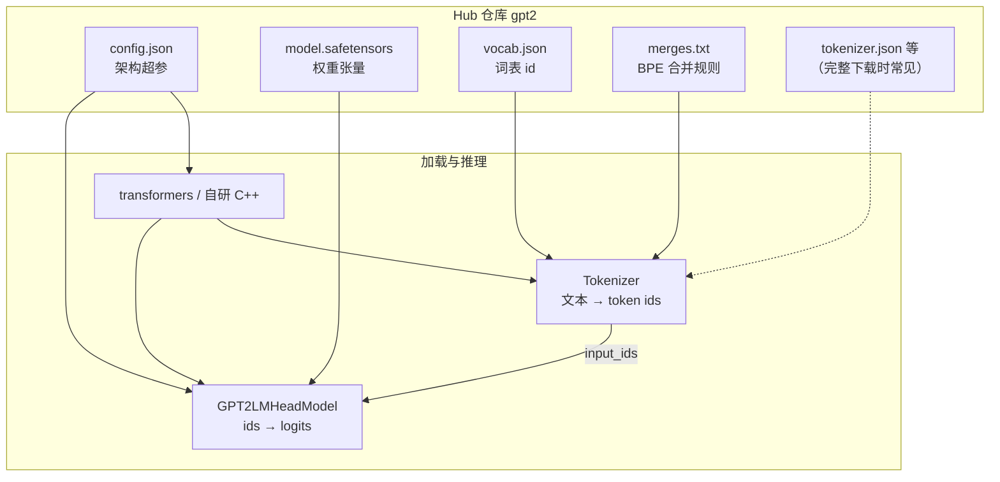
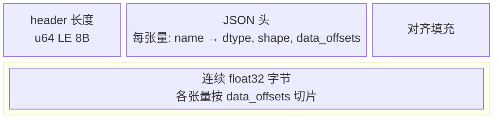
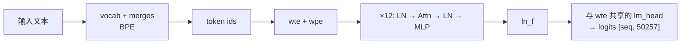

# Hugging Face 模型文件导览（以 GPT-2 为例）

图形版（推荐在浏览器打开）：[`huggingface_model_files.html`](huggingface_model_files.html)

逐步推理与张量计算（矩阵示意）：[`gpt2_inference_flow.html`](gpt2_inference_flow.html)

本仓库示例目录：[`data/gpt2/`](../data/gpt2/)（`config.json`、`vocab.json`、`merges.txt`、`model.safetensors`）。

---

## 1. 这些文件从哪来？

从 [Hugging Face Hub](https://huggingface.co/) 拉取模型时，常见方式：

```bash
# 需要：pip install huggingface_hub
huggingface-cli download gpt2 --local-dir data/gpt2
# 或
python -c "from huggingface_hub import snapshot_download; snapshot_download('gpt2', local_dir='data/gpt2')"
```

Hub 上每个模型是一个**文件集合**；`transformers` 根据文件名与 `config.json` 里的 `model_type` 自动拼装 `GPT2LMHeadModel` 与分词器。

---

## 2. 文件关系总览（Mermaid）



**分工简述**

| 文件 | 管什么 | 不管什么 |
|------|--------|----------|
| `config.json` | 层数、隐藏维、头数、词表大小、激活函数等 | 具体浮点权重 |
| `vocab.json` + `merges.txt` | 子词 ↔ 整数 id（GPT-2 用 BPE） | 神经网络计算 |
| `model.safetensors` | 全部可学习参数（按名称索引） | 文本怎么切分 |

---

## 3. `config.json`：模型的「蓝图」

本仓库 [`data/gpt2/config.json`](../data/gpt2/config.json) 摘录与含义：

| 字段 | 示例值 | 作用 |
|------|--------|------|
| `model_type` | `gpt2` | 选择 `AutoModel` 用哪套实现 |
| `architectures` | `GPT2LMHeadModel` | 带语言模型头的类名 |
| `n_layer` | `12` | Transformer 解码器层数 |
| `n_head` | `12` | 每层注意力头数（`n_embd / n_head = 64` 为每头维度） |
| `n_embd` | `768` | 隐藏向量宽度 |
| `n_ctx` / `n_positions` | `1024` | 最大上下文长度（位置编码与 mask 上限） |
| `vocab_size` | `50257` | 词表大小（与 `wte` 行数一致） |
| `activation_function` | `gelu_new` | MLP 内激活 |
| `bos_token_id` / `eos_token_id` | `50256` | GPT-2 用 `<|endoftext|>` 兼作 BOS/EOS |

推理时：**先**用 config 分配张量形状与算子，**再**从 `model.safetensors` 按名称填权重。

---

## 4. 分词器：`vocab.json` 与 `merges.txt`

### 4.1 `vocab.json`

- 格式：JSON 对象，`"子词字符串" → 整数 id`。
- 本模型约 **50257** 条；字节级 BPE 下很多「词」是带 `Ġ`（空格）前缀的片段。
- id **50256** 对应 `<|endoftext|>`（与 config 里 `eos_token_id` 一致）。

### 4.2 `merges.txt`

- 首行 `#version: 0.2` 为格式版本。
- 其后每行一对符号，表示 BPE **合并优先级**（越靠前越先合并）。
- 编码流程（概念上）：UTF-8 字节 → 初始符号 → 按 merges 反复合并 → 在 vocab 里查 id。

完整 Hub 包还可能包含 `tokenizer_config.json`、`tokenizer.json`（Rust `tokenizers` 序列化）、`special_tokens_map.json`；**仅** `vocab.json` + `merges.txt` 也足以复现经典 GPT-2 BPE。

---

## 5. `model.safetensors`：权重容器

### 5.1 为何用 SafeTensors？

- 头部是 **JSON 元数据** + 尾部连续 **二进制 payload**，可按名称 `mmap` 切片。
- 加载时**不执行 pickle**，比传统 `pytorch_model.bin` 更安全。
- 本文件约 **548 MB**，`__metadata__.format = pt` 表示按 PyTorch 习惯存张量。

### 5.2 文件布局



`data_offsets: [start, end)` 为**相对 payload 起点**的字节区间（非文件绝对偏移；绝对位置 = `8 + header_len + start`）。

### 5.3 GPT-2 张量命名（本仓库 160 个）

与 `config` 的 `n_layer=12` 对应：

| 名称模式 | 含义 | 典型 shape（GPT-2 small） |
|----------|------|---------------------------|
| `wte.weight` | 词嵌入（并与输出 lm_head **共享**） | `[50257, 768]` |
| `wpe.weight` | 位置嵌入 | `[1024, 768]` |
| `h.{i}.ln_1.*` | 块内注意力前 LayerNorm | weight/bias `[768]` |
| `h.{i}.attn.c_attn.*` | QKV 合并线性层 | weight `[768, 2304]`，bias `[2304]` |
| `h.{i}.attn.c_proj.*` | 注意力输出投影 | weight `[768, 768]` |
| `h.{i}.attn.bias` | 因果注意力 mask 缓冲 | `[1, 1, 1024, 1024]` |
| `h.{i}.ln_2.*` | MLP 前 LayerNorm | `[768]` |
| `h.{i}.mlp.c_fc.*` | MLP 升维（×4） | weight `[768, 3072]` |
| `h.{i}.mlp.c_proj.*` | MLP 降维 | weight `[3072, 768]` |
| `ln_f.*` | 最终 LayerNorm | `[768]` |

**没有**单独的 `lm_head.weight`：GPT-2 把输出层与 `wte` 绑在一起（weight tying）。

---

## 6. 一次前向的数据流



- **config** 决定 `12` 层、`768` 维等结构。
- **safetensors** 提供每一层的 `weight` / `bias`。
- **vocab / merges** 只参与两端：编码输入、解码采样出的 id。

---

## 7. 与完整 Hub 目录的差异

| 文件 | 本仓库 `data/gpt2` | 完整 `gpt2` 仓库常见 |
|------|--------------------|----------------------|
| `config.json` | ✓ | ✓ |
| `model.safetensors` | ✓ | ✓（或 `pytorch_model.bin` / 分片 + `*.index.json`） |
| `vocab.json` / `merges.txt` | ✓ | ✓ |
| `tokenizer.json` | — | 常有 |
| `generation_config.json` | — | 常有（默认生成超参） |
| `README.md` / `LICENSE` | — | 常有 |

分片大模型时会有 `model-00001-of-00002.safetensors` 与 `model.safetensors.index.json` 描述「逻辑张量名 → 物理文件」映射；单文件 GPT-2 不需要 index。

---

## 8. 和本项目的 INFR 格式对比

| | Hugging Face `safetensors` | 本项目 [`infr_format.md`](infr_format.md) |
|--|---------------------------|---------------------------------------------|
| 用途 | 通用 Hub 生态 | 本仓库 C++ `ModelFile` 读取 |
| 张量名 | PyTorch 模块路径风格 | 自定义（如 `fc1.weight`） |
| 典型模型 | GPT-2、LLaMA 等 | MNIST MLP 演示 |

学习推理实现时：可把 Hub 文件当作**标准参考布局**，再对照自研加载器需要哪些字段。

---

## 9. 进一步阅读

- [SafeTensors 格式说明](https://huggingface.co/docs/safetensors/index)
- [GPT-2 原论文与 OpenAI 博客](https://openai.com/research/better-language-models)
- Hub 模型卡片：<https://huggingface.co/gpt2>
