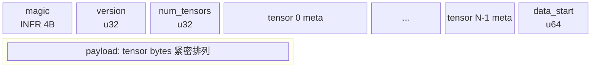

# INFR 模型文件格式

图形版（推荐在浏览器打开）：[`infr_format.html`](infr_format.html)

由 [`tools/train_mnist_numpy.py`](../tools/train_mnist_numpy.py) 的 `save()` 写出，C++ [`ModelFile`](../include/inference/model_file.hpp) 读取。扩展名常用 `.inference`。

---

## 文件布局（Mermaid）

`data_start` 指向数据区在**整个文件**中的首字节。每张量的 `offset` / `nbytes` 相对于**数据区起点**。

---

## 张量元信息（重复 `num_tensors` 次）

| 字段 | 类型 | 说明 |
|------|------|------|
| `name_len` | uint32 LE | 名称字节数 |
| `name` | UTF-8 | 如 `fc1.weight` |
| `dtype` | uint32 LE | `0` = float32 |
| `ndim` | uint32 LE | 形状维数 |
| `dims` | int64 LE × ndim | NumPy `shape` |
| `offset` | uint64 LE | 数据区内偏移 |
| `nbytes` | uint64 LE | 须为 `numel × 4` |

---

## 示例文件

| 文件 | 张量 |
|------|------|
| `data/models/mnist_mlp.inference` | `fc1.weight`, `fc1.bias`, `fc2.weight`, `fc2.bias` |
| `data/models/mnist_activation.inference` | `input`, `z1`, `h1`, `z2`, `prob` |
| `data/models/mnist_samples.inference` | `images`, `labels` |

生成：`python3 tools/train_mnist_numpy.py`
