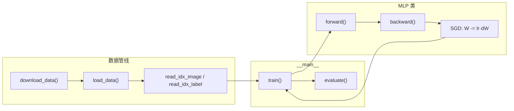
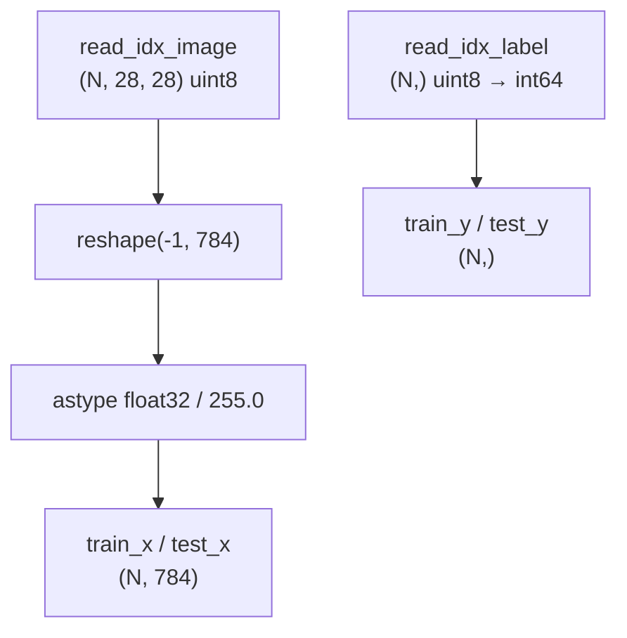
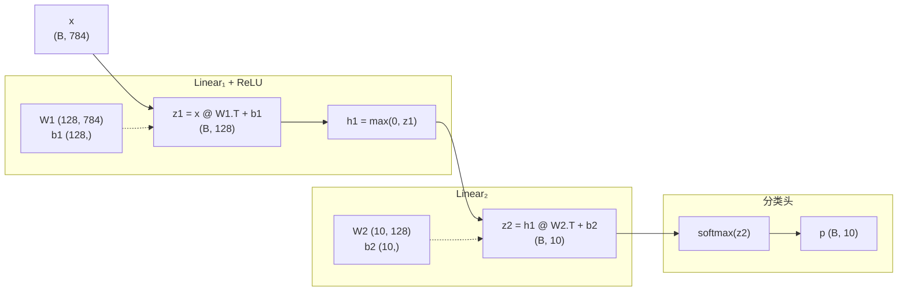
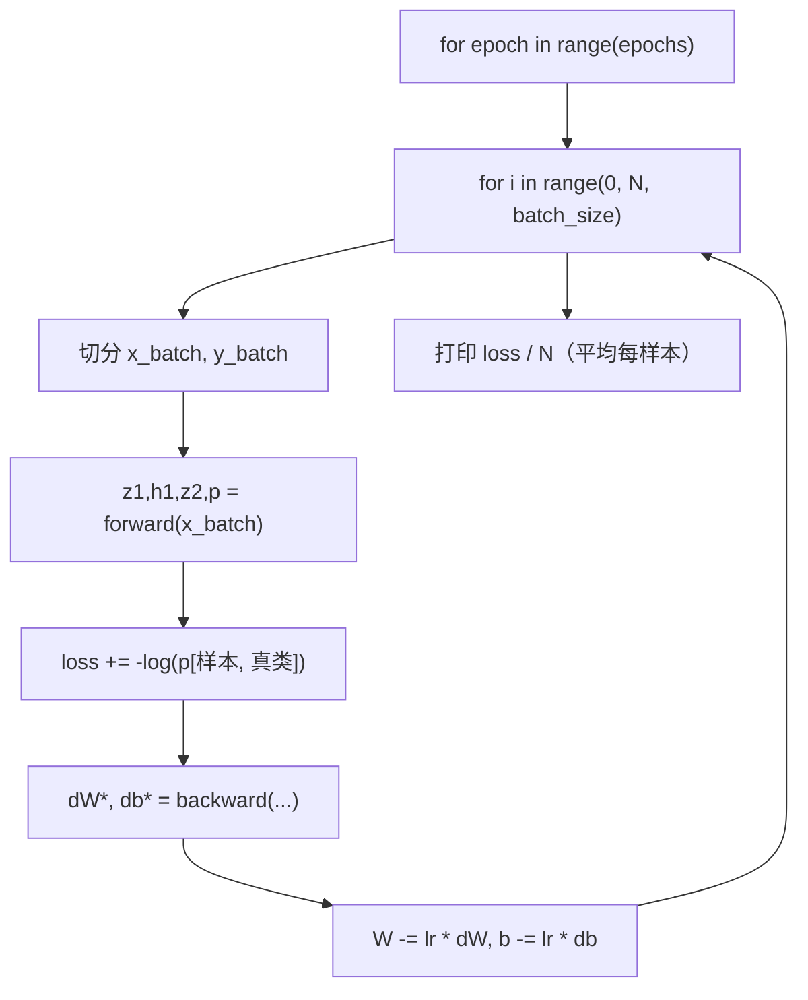
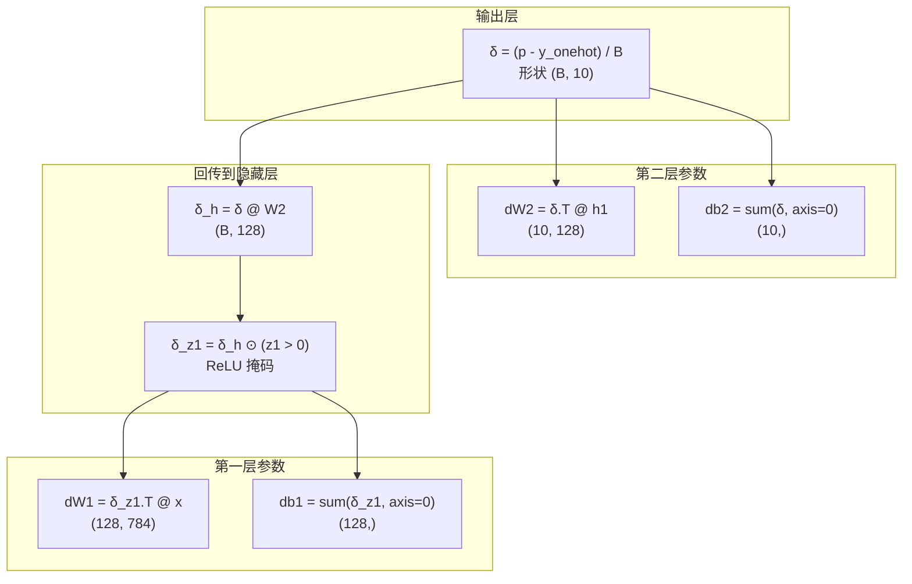
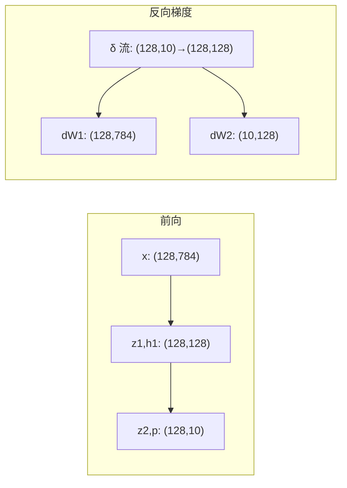
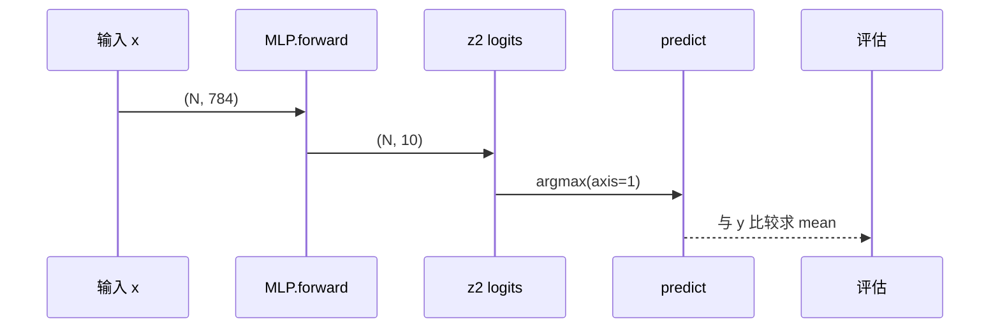
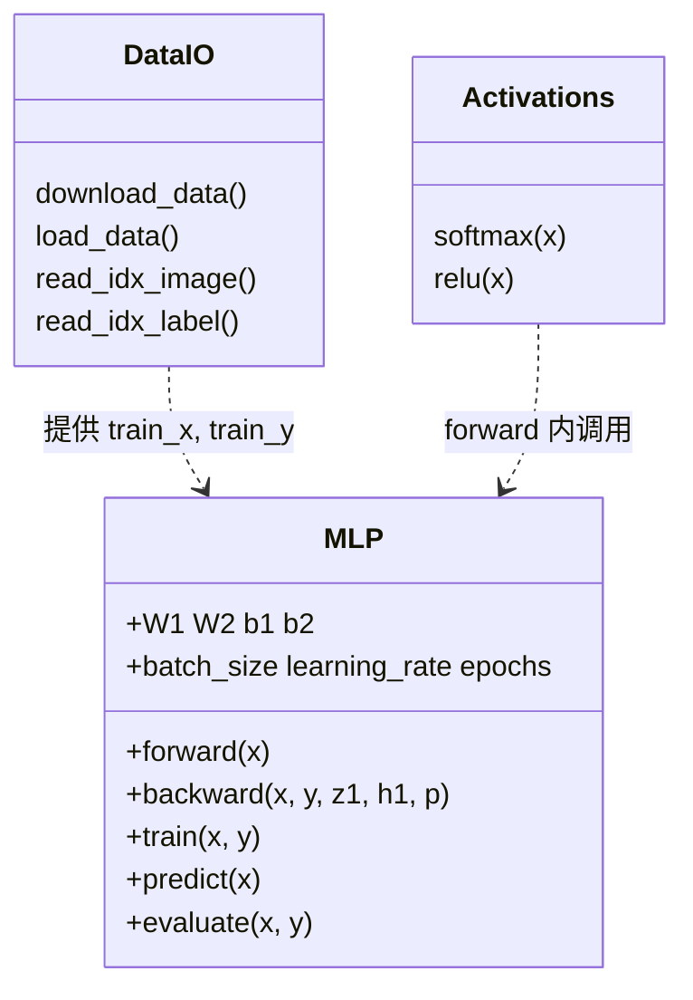

# `train_mnist_numpy.py` 实现说明

本文档图解 [`tools/train_mnist_numpy.py`](../tools/train_mnist_numpy.py)：用纯 NumPy 在 MNIST 上训练一个两层 MLP，并手写前向 / 反向传播。

在支持 Mermaid 的 Markdown 预览（VS Code、GitHub、Cursor 等）中可直接渲染下图。

---

## 1. 脚本总览



| 阶段 | 函数 | 作用 |
|------|------|------|
| 下载 | `download_data` | 从镜像拉取 4 个 MNIST `.gz` 到 `data/mnist/` |
| 加载 | `load_data` | 解析 IDX → `float32` 特征与 `int64` 标签 |
| 训练 | `MLP.train` | 多 epoch、mini-batch 前向 + 反传 + 更新 |
| 评估 | `MLP.evaluate` | 测试集分类准确率 |

运行：

```bash
python3 tools/train_mnist_numpy.py
```

**网页动画演示**：

- 流程总览：[`train_mnist_numpy_demo.html`](train_mnist_numpy_demo.html)
- **一个 batch 的逐步推理与训练**（矩阵示意图 + 放大的真实数值，16 步，单文件可直接双击打开）：[`train_mnist_step_by_step.html`](train_mnist_step_by_step.html)  
  重新生成：`python3 tools/build_mnist_step_demo.py`
- **矩阵逐元素**（`B=100`，含完整 `x/W/b/δ/dW` 与 SGD 前后数值）：[`train_mnist_numpy_matrices.html`](train_mnist_numpy_matrices.html)  
  **必须用系统浏览器 + HTTP**（Cursor/VS Code 内置预览不会跑 JS，会一直停在「正在初始化」）：`cd docs && python3 -m http.server 8765` → Chrome/Edge 打开 `http://127.0.0.1:8765/train_mnist_numpy_matrices.html`（需同目录存在 `.js` 与 `.json.gz`）  
  重新导出：`python3 tools/export_mnist_matrix_demo.py && python3 tools/build_mnist_matrix_demo_html.py`

---

## 2. MNIST 与 IDX 格式

### 2.1 数据文件

| 键 | 文件名 | 内容 |
|----|--------|------|
| `train_x` | `train-images-idx3-ubyte.gz` | 60000 张 28×28 灰度图 |
| `train_y` | `train-labels-idx1-ubyte.gz` | 60000 个标签 0–9 |
| `test_x` | `t10k-images-idx3-ubyte.gz` | 10000 张图 |
| `test_y` | `t10k-labels-idx1-ubyte.gz` | 10000 个标签 |

### 2.2 IDX 二进制布局

所有 **32 位整数为大端（big-endian）**。

**标签 `idx1`（magic = 2049）**

```text
┌────────┬────────┬──────────────────┐
│ magic  │   N    │  N × uint8 标签   │
│ 4 byte │ 4 byte │                  │
└────────┴────────┴──────────────────┘
```

**图像 `idx3`（magic = 2051）**

```text
┌────────┬────────┬──────┬──────┬─────────────────────┐
│ magic  │   N    │ rows │ cols │ N×rows×cols 像素 uint8 │
│ 4 byte │ 4 byte │  28  │  28  │  按图→行→列存储        │
└────────┴────────┴──────┴──────┴─────────────────────┘
```

### 2.3 加载后的张量形状



---

## 3. 模型结构

默认超参：`d_in=784`, `d_hidden=128`, `d_out=10`, `batch_size=128`, `learning_rate=0.1`, `epochs=12`。

### 3.1 与 PyTorch `nn.Linear` 一致的权重布局

- 权重 **`W` 形状为 `(out, in)`**
- 前向：**`y = x @ W.T + b`**



ASCII 数据流（单样本维度）：

```text
  784          128                    10
   x ──────► z1 ──ReLU──► h1 ──────► z2 ──softmax──► p
         W1.T+b1              W2.T+b2
```

### 3.2 参数一览

| 参数 | 形状 | 初始化 |
|------|------|--------|
| `W1` | `(128, 784)` | He：`N(0,1) * sqrt(2/784)` |
| `b1` | `(128,)` | 0 |
| `W2` | `(10, 128)` | He：`N(0,1) * sqrt(2/128)` |
| `b2` | `(10,)` | 0 |

He 初始化配合中间层 **ReLU**，缓解前向时激活方差过大或过小。

### 3.3 Softmax（数值稳定）

对每一行（每个样本的 10 个 logit）：

1. `z' = z - max(z)`（按行）
2. `p = exp(z') / sum(exp(z'))`

`forward` 返回 `z1, h1, z2, p`，训练时 `backward` 需要 `z1, h1, p`；`predict` 对 `z2` 做 `argmax`（与对 `p` 做 `argmax` 等价）。

---

## 4. 训练循环



### 4.1 损失函数

对当前 mini-batch，使用 **交叉熵**（对 batch 内样本 **求和**）。

记 batch 大小为 `B`，第 `b` 个样本的真实类别为 `y_b`，模型对类别 `k` 的概率为 `p[b, k]`，数值稳定项 `ε = 1e-9`（代码里写作 `1e-9`）。

$$
L_{\mathrm{batch}} = -\sum_{b=1}^{B} \log\left( p_{b,\,y_b} + \epsilon \right)
$$

与代码一致（对 batch 内正确类概率取负对数再求和）：

```text
loss += -log(p[arange(B), y_batch] + 1e-9).sum()
```

日志中的 `Loss: loss / x.shape[0]` 是 **整个训练集上平均每样本** 的 CE。

### 4.2 优化器

**SGD（随机梯度下降）**，无动量、无 weight decay：

```text
θ ← θ - learning_rate · ∇θ
```

---

## 5. 反向传播

记 `B` 为当前 batch 大小，`y_onehot` 由整数标签 `y_batch` 散射得到。

### 5.1 计算图（数据从输出往回）



### 5.2 公式与代码对应

| 步骤 | 数学 | 代码 |
|------|------|------|
| Softmax + CE 对 `z2` | `∂L/∂z2 = p - y`（再除以 `B` 作平均梯度） | `delta = (p - y_onehot) / batch_size` |
| `W2`, `b2` | `dW2 = δᵀ h1`, `db2 = Σ δ` | `delta.T @ h1`, `delta.sum(0)` |
| 传到 `h1` | `∂L/∂h1 = δ W2` | `delta @ self.W2` |
| ReLU | `∂L/∂z1 = ∂L/∂h1` 仅在 `z1>0` | `* (z1 > 0)` |
| `W1`, `b1` | `dW1 = δ_z1ᵀ x`, `db1 = Σ δ_z1` | `delta.T @ x_batch` |

除以 `batch_size` 的原因：前向 loss 对 batch 是 **求和**，若希望更新步长与 `learning_rate=0.1` 在常见设定下匹配，对梯度做 **batch 平均** 更稳定（等价于对平均 loss 求导）。

### 5.3 前向 / 反向形状检查（`B=128`）



---

## 6. 推理与评估



`evaluate(x, y)` 返回 **准确率** `mean(predict(x) == y)`。

---

## 7. 模块依赖关系



---

## 8. 与 C++ 推理项目的关系

本仓库 `learn_inference` 侧重 C++ 张量与算子实现。该 Python 脚本可用于：

1. **生成可对照的数值**：同一 `(out,in)` 布局的 `W、b`，便于在 C++ 里实现 `matmul + bias + relu + softmax` 并逐层比对。
2. **理解训练得到的权重从哪来**：导出 `W1, b1, W2, b2`（例如 `np.savez` 到 `data/models/`）后，在 C++ 端只做前向推理。

后续若实现权重导出，建议在文档中补充二进制 / NPZ 字段名与维度表。

---

## 9. 超参对比可视化

使用 Matplotlib 对比不同 `batch_size` / `learning_rate`（需安装 `matplotlib`）：

```bash
cd tools
python3 plot_mnist_training_compare.py          # 默认 10 epoch，较耗时
python3 plot_mnist_training_compare.py --fast  # 快速试跑
```

输出目录 `docs/figures/`：

| 文件 | 内容 |
|------|------|
| `mnist_batch_size_compare.png` | 固定 `lr=0.1`，比较 batch 64/100/128/256：loss、train/test acc、最终准确率与耗时 |
| `mnist_lr_compare.png` | 固定 `batch=128`，比较 lr：曲线与最终 test acc |
| `mnist_training_summary.png` | 实验汇总表 |
| `mnist_training_results.json` | 数值结果与逐 epoch 历史（便于复现） |

`MLP.train(..., test_x=, test_y=, train_eval_x=)` 会在 `self.history` 中记录 `train_loss`、`test_acc`、子集 `train_acc` 等。

---

## 10. 参考

- [MNIST 官网](http://yann.lecun.com/exdb/mnist/) — IDX 格式说明  
- PyTorch [`nn.Linear`](https://pytorch.org/docs/stable/generated/torch.nn.Linear.html) — `weight` 为 `(out_features, in_features)`  
- He et al., *Delving Deep into Rectifiers* — ReLU 的 He 初始化  
